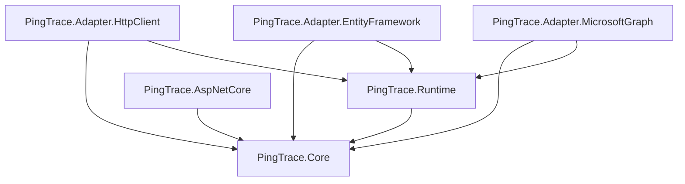
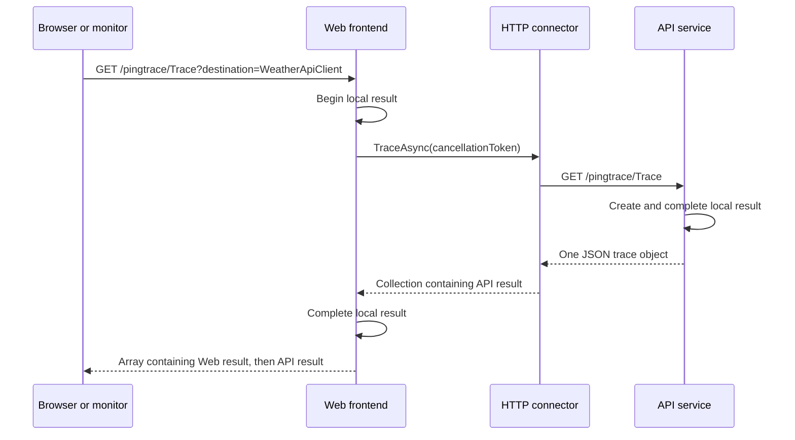

# Architecture

PingTrace separates diagnostic contracts, execution, incoming HTTP requests,
and outgoing dependency calls.

This separation allows applications to use the runtime without hosting
HTTP endpoints and to add communication adapters without changing the
core contracts.

This page describes the current implementation. See
[capability boundaries](../design/CAPABILITY-BOUNDARIES.md) for planned work.

## Libraries

| Library | Responsibility | Direct project references |
| --- | --- | --- |
| `PingTrace.Core` | Diagnostic contracts and result model | None |
| `PingTrace.Runtime` | Default execution and service registration | Core |
| `PingTrace.AspNetCore` | Incoming HTTP endpoint mapping | Core |
| `PingTrace.Adapter.HttpClient` | Outgoing HTTP dependency calls and adapter registration | Core, Runtime |
| `PingTrace.Adapter.EntityFramework` | SQL Server diagnostics and destination registration | Core, Runtime |
| `PingTrace.Adapter.MicrosoftGraph` | Organization diagnostics and destination registration | Core, Runtime |

All six libraries currently target .NET 10.

The following arrows represent project references, not network requests:



The HTTP adapter references Runtime because its registration extensions
operate on `PingTraceBuilder`. Runtime does not reference the HTTP adapter.

The ASP.NET Core library depends on `IPingTrace`, not `DefaultPingTrace`.
A host can therefore supply another implementation without changing
endpoint mapping.

## Core contracts

`PingTrace.Core` defines the following public building blocks:

| Type | Role |
| --- | --- |
| `IPingTrace` | Provides Ping, local Trace, destination Trace, and recursive TraceAll |
| `IPingTraceConnector` | Invokes a configured dependency |
| `IRecursivePingTraceConnector` | Continues TraceAll on a participating dependency |
| `TraceAllRequest` | Carries remaining depth, deadline, and ancestor path |
| `TraceResult` | Carries one component's diagnostic observations |

These contracts contain no ASP.NET Core routing types or HTTP client
configuration.

A connector exposes a name and returns a collection of trace results.
The collection allows a connector to supply multiple observations without
requiring the runtime to understand the underlying transport.

The HTTP connector returns one remote observation for named Trace and a remote
result array for TraceAll.

## Runtime

`PingTrace.Runtime` supplies `DefaultPingTrace`, dependency-injection
registration, and the registration builder.

The default runtime owns:

- The local application result.
- Selection of a connector by destination name.
- Ordering the local result before dependency results.
- Completing the local result after the dependency call.

Connectors own communication with dependencies.

This division keeps transport details such as addresses, authentication,
and response parsing outside the default runtime.

## Service registration

A leaf application registers the default runtime with:

```csharp
builder.Services.AddPingTrace();
```

An application with HTTP dependencies uses the registration callback:

```csharp
builder.Services.AddPingTrace(pingTrace =>
{
    pingTrace.AddHttpDestination("ApiService", client =>
    {
        client.BaseAddress = new Uri("https://api.example.com/");
    });
});
```

The callback receives a `PingTraceBuilder`. It executes during registration
and allows adapters to add services to the application's service collection.

It does not execute a trace or configure `PingTraceOptions`.

`AddPingTrace()` uses `TryAddScoped` to register `IPingTrace`. An existing
registration is preserved, allowing an application to supply its own
implementation through ordinary dependency injection.

`TraceAllNode` is registered as a singleton in Runtime. Its transient identity
is shared across request scopes, allowing recursive calls to recognize a return
to the same application instance without relying on entry-assembly names.

A generic `AddPingTrace<T>()` overload is not currently implemented.

### Lifetime and validation

The default runtime and registered HTTP connectors use scoped lifetimes.

When the runtime is resolved, it receives the registered connectors and
builds a case-insensitive lookup by name.

It rejects:

- Null connectors.
- Empty connector names.
- Duplicate names, ignoring case.
- Names that conflict with the local application name.

These checks occur when the runtime is constructed, not necessarily when
the registration callback executes.

Resolving the runtime also constructs its connectors. Connector constructors
should therefore avoid network calls and expensive work, even though Ping
and local Trace never invoke connector tracing methods.

## Local identity and results

The default application name comes from the managed entry assembly.

Each local result also reports:

- `Environment.MachineName`.
- The environment domain and user name.
- Start and finish timestamps.
- A string payload.
- Elapsed time calculated from the timestamps.

The entry assembly may belong to a test runner or specialized host.
The current runtime throws if it cannot determine an entry-assembly name.

The reported runtime identity does not necessarily identify the credentials
used by an outgoing connection.

There are no diagnostic application IDs. Destination aliases and responding
application names serve different purposes and do not need to match.

## Incoming HTTP requests

`PingTrace.AspNetCore` maps endpoints using:

```csharp
app.MapPingTrace();
```

The default prefix is `/pingtrace`. A string argument changes it:

```csharp
app.MapPingTrace("/diagnostics");
```

| Request | Runtime operation | Successful response |
| --- | --- | --- |
| `GET /pingtrace/Ping` | `Ping()` | Plain-text string |
| `GET /pingtrace/Trace` | Local `TraceAsync()` | One JSON object |
| `GET /pingtrace/Trace?destination=NAME` | Named `TraceAsync(NAME)` | JSON array |
| `GET /pingtrace/TraceAll` | `TraceAllAsync()` with default context | JSON array |
| `POST /pingtrace/TraceAll` | `TraceAllAsync(request)` with received context | JSON array |

The endpoint adapter resolves `IPingTrace` from the request's services.
For trace requests, it passes `HttpContext.RequestAborted` to the runtime.

The current implementation explicitly maps GET endpoints and POST TraceAll. HEAD support
has been discussed but is not implemented.

### Authorization

`MapPingTrace()` returns a `RouteGroupBuilder`. The host can apply ordinary
endpoint conventions to the group:

```csharp
app.MapPingTrace().RequireAuthorization();
```

This applies authorization to Ping, Trace, and both TraceAll endpoints. The host must configure
the corresponding authentication and authorization services.

Separate anonymous Ping and protected Trace mapping remains planned work.

## Execution paths

### Ping

Ping returns `Pong`.

It does not create trace results or invoke dependency connectors.

### Local Trace

Local Trace creates and completes one local result. Its payload contains the managed entry assembly's version, falling back to `Pong` when the version is unavailable.

It does not invoke dependency connectors.

The current return value is a single `TraceResult`, not a collection.

### Named local Trace

If the requested destination matches the local application name,
the runtime performs local Trace and wraps the result in a one-element
collection.

This preserves the destination overload's collection return type.

### Dependency Trace

For a registered dependency, the runtime:

1. Finds the connector by its local registration name.
2. Creates the local trace result.
3. Awaits the connector's trace operation.
4. Appends the connector's results after the local result.
5. Completes the local result with `{version} --> [{destination}]`.
6. Returns the collection.

The runtime preserves the order of the results supplied by the connector.

It does not infer parent-child relationships or recursively traverse
returned results.

## Outgoing HTTP adapter

TraceAll visits connectors sequentially in case-insensitive ordinal name order.
Recursive connectors receive a new path context; other connectors are leaves.
Shared dependencies are visited per path. Cycle detection, depth limits, and
cooperative deadlines stop invalid or excessive traversal without returning
partial result collections. See [recursive execution](PINGTRACE.md#recursive-traceall).

`PingTrace.Adapter.HttpClient` registers a named HTTP client and a connector
for each destination.

The connector creates its client through `IHttpClientFactory` when tracing
executes. Named destination Trace sends GET to `/pingtrace/Trace` by default;
TraceAll sends POST to `/pingtrace/TraceAll` with the traversal context.

For named destination Trace, the adapter expects one JSON trace object.
It rejects a null result or a result with an empty name, then wraps a valid
result in a collection for the runtime.

For TraceAll, it expects a nonempty array of non-null, named trace results.
The remote application continues traversal using the received context. Both
paths are independently configurable, and recursive requests never fall back
to local Trace when the remote endpoint is unavailable.

It does not replace the remote application's name with the local
destination alias.

Each destination can configure its own base address and client behavior.
`AddHttpDestination()` returns `IHttpClientBuilder`, allowing the application
to add handlers and other HTTP configuration.

A diagnostic client is separate from an application's business client.
Sharing a base address does not automatically share client-specific
authentication handlers or headers.

## Aspire sample communication

The sample frontend registers a destination named `WeatherApiClient`.

Its base address is `https+http://apiservice`, using service discovery
configured by the sample's service defaults.

The API service registers a default leaf runtime and maps its own
PingTrace endpoints.

The following diagram represents runtime communication:



The frontend's destination alias selects the connector. It is not forwarded
as a destination query parameter to the API.

The API's local Trace does not invoke any dependencies of its own.
Consequently, adding dependencies to the API would not make this frontend
request recursively visit them.

Requesting the frontend's `/pingtrace/TraceAll` instead continues through the
API's recursive endpoint and then its configured `ApiServiceDb` and
`MicrosoftGraph` leaf connectors. Graph uses an in-memory simulation in this
sample; it does not contact Microsoft services.

Aspire service discovery resolves the service address. It is independent
of the PingTrace destination discovery capability excluded from version 1.

## Timing boundaries

The local result begins after destination lookup and ends after the
connector results have been collected.

Its duration includes the awaited dependency operation. It does not include
all work from incoming HTTP request arrival through final response
serialization.

A remote result measures the remote application's local trace operation.

These measurements overlap. Adding them would double-count some work.

HTTP client configuration can also affect observed duration through retries,
connection establishment, authentication, and other handlers.

The current `TraceResult` uses `DateTime.Now` and subtracts start from finish.
It does not yet use a monotonic timer.

## Failure behavior

The default runtime propagates connector failures and cancellation.
It does not return a partial successful collection when a connector fails.

At the HTTP boundary:

- An empty destination query produces status 400.
- `KeyNotFoundException` from destination execution produces status 404.
- Other exceptions propagate to the host's exception handling.

The current handler catches `KeyNotFoundException` around the complete
destination operation. A custom connector throwing that exception would
therefore also be translated to 404.

The HTTP connector preserves unsuccessful HTTP responses as HTTP failures.
For example, a remote 404 is not converted into a local destination lookup
failure.

The host determines the final response for unhandled failures.

## Extension boundaries

An application can extend PingTrace at these points:

| Extension point | Purpose |
| --- | --- |
| `IPingTrace` | Replace application-level diagnostic behavior |
| `IPingTraceConnector` | Communicate with another kind of dependency |
| `IRecursivePingTraceConnector` | Continue recursive traversal with the supplied context |
| Builder extension methods | Register an adapter and its supporting services |

The EF Core adapter uses these extension boundaries without adding EF Core
dependencies to Runtime or Core. It registers a scoped connector, resolves
the application's context when selected, and executes a SQL Server-specific
diagnostic query.

## Current limits

The architecture provides explicit named dependency invocation and recursive
TraceAll over registered connectors.

It does not yet provide:

- Destination discovery.
- Automatic multi-hop destination routing.
- A branching graph result model.
- Structured object payloads.
- Trace construction helpers.
- A Blazor result viewer.
- Built-in health classification or recovery actions.

These boundaries keep monitoring policy with the application or monitoring
system while PingTrace supplies diagnostic observations.

## Related documentation

- [Definitions](PINGTRACE-DEFINITIONS.md)
- [Execution model](PINGTRACE.md)
- [Extension contracts](PLUGIN-ARCHITECTURE.md)
- [Distributed hosting](DISTRIBUTED-HOSTING.md)
- [Security](SECURITY.md)
- [Capability boundaries](../design/CAPABILITY-BOUNDARIES.md)
