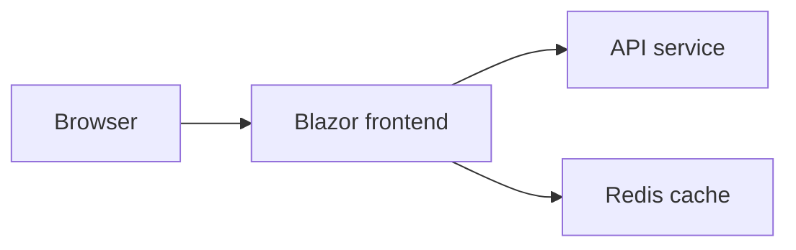
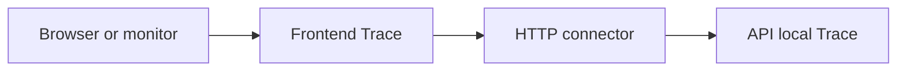

# Distributed hosting

Each participating application registers its own PingTrace runtime and
exposes its own diagnostic endpoints.

An application that calls another system explicitly registers a connector
for that dependency. The connector owns the outgoing communication; the
remote application owns its diagnostic response.

PingTrace does not require Aspire. The included Aspire sample demonstrates
how this arrangement works with service discovery and application hosting.

## Sample topology

The sample contains:

| Component | Role |
| --- | --- |
| `AspireAppSample.AppHost` | Declares application resources and references |
| `AspireAppSample.Web` | Blazor frontend and caller of the API |
| `AspireAppSample.ApiService` | API providing weather data and local diagnostics |
| `AspireAppSample.ServiceDefaults` | Shared service discovery, resilience, telemetry, and health-check setup |
| Redis resource named `cache` | Frontend output-cache dependency |

The application dependencies are:



The current PingTrace dependency registration covers only the API:



Redis is part of the application's topology, but no PingTrace connector
is registered for it.

The sample API currently has no database dependency.

## AppHost resource references

The AppHost declares the API under the service name `apiservice`.
It gives the frontend references to that API and the Redis resource.

The relevant existing registration is:

```csharp
var cache = builder.AddRedis("cache");

var apiService =
    builder.AddProject<Projects.AspireAppSample_ApiService>("apiservice")
        .WithHttpHealthCheck("/health");

builder.AddProject<Projects.AspireAppSample_Web>("webfrontend")
    .WithExternalHttpEndpoints()
    .WithHttpHealthCheck("/health")
    .WithReference(cache)
    .WaitFor(cache)
    .WithReference(apiService)
    .WaitFor(apiService);
```

These declarations belong to the sample's hosting configuration.

They do not register PingTrace connectors. The frontend separately declares
which dependency it wants to trace.

The AppHost's health-check paths remain `/health`; PingTrace does not
replace them.

## Frontend registration

The frontend uses one service address for its weather client and its
diagnostic client:

```csharp
Uri apiServiceUri = new("https+http://apiservice");

builder.Services.AddHttpClient<WeatherApiClient>(client =>
{
    client.BaseAddress = apiServiceUri;
});

builder.Services.AddPingTrace(pingTrace =>
{
    pingTrace.AddHttpDestination(nameof(WeatherApiClient), client =>
    {
        client.BaseAddress = apiServiceUri;
    });
});
```

The relevant namespaces are:

```csharp
using PingTrace.Adapter.HttpClient;
using PingTrace.AspNetCore;
using PingTrace.Runtime;
```

After building the application, the frontend maps its endpoints:

```csharp
app.MapPingTrace();
```

`nameof(WeatherApiClient)` produces the destination alias
`WeatherApiClient`. It does not instruct PingTrace to resolve or invoke
the weather client class.

The HTTP adapter registers a separate named client for diagnostic requests.

## API registration

The API is currently a PingTrace leaf:

```csharp
builder.Services.AddPingTrace();
```

After building the application:

```csharp
app.MapPingTrace();
```

The API needs Runtime and AspNetCore. It does not need the outgoing HTTP
adapter unless it also traces an HTTP dependency.

A leaf still provides Ping, local Trace, and named local Trace.

## Service address resolution

Both applications call the sample's `AddServiceDefaults()` method.

That method registers service discovery and applies service discovery
and standard resilience handlers to factory-created HTTP clients.

The frontend's `https+http://apiservice` address relies on this setup.
The logical service name is resolved using the host-provided service
configuration.

Do not copy that address into an otherwise unconfigured application and
expect an ordinary HTTP client to resolve it.

Outside the sample, either configure compatible service discovery or use
the dependency's actual HTTP or HTTPS address.

Aspire service discovery and PingTrace destination registration have
different responsibilities:

| Mechanism | Responsibility |
| --- | --- |
| Service discovery | Resolve a logical service address |
| PingTrace registration | Associate a local diagnostic alias with a connector |

PingTrace does not expose a destination-discovery endpoint.

## Names used in a trace

Several names participate in the sample:

| Name | Meaning |
| --- | --- |
| `webfrontend` | Frontend resource name in AppHost |
| `apiservice` | API resource and service-discovery name |
| `WeatherApiClient` | Frontend's PingTrace destination alias |
| `AspireAppSample.Web` | Default frontend application name |
| `AspireAppSample.ApiService` | Default API application name |

The default application names come from the managed entry assemblies.

The names need not match because they serve different purposes. Registering
the alias `WeatherApiClient` does not rename the API's trace result.

## Request path

Using the frontend address shown by Aspire, request:

```text
/pingtrace/Trace?destination=WeatherApiClient
```

The frontend selects the connector registered under that alias.

The connector requests the API's:

```text
/pingtrace/Trace
```

The API returns one local result. The frontend returns an array containing
its own result followed by the API result.

The outgoing request does not contain
`destination=WeatherApiClient`. That alias belongs to the frontend's
configuration.

The API's local Trace does not invoke its own dependencies. Its configured
database connector is therefore not invoked by this named frontend request.
Request `/pingtrace/TraceAll` from the frontend to continue through the API
to its `ApiServiceDb` diagnostics instead.

## What a successful request establishes

A successful frontend-to-API trace demonstrates that, for that request:

- The frontend's diagnostic endpoint executed.
- Its selected diagnostic client reached a compatible API endpoint.
- The API returned a named trace result.
- The frontend received and deserialized that result.

The returned names, machine information, identities, and payloads provide
evidence about the components that responded.

This request does not execute `/weatherforecast`, verify Redis, or
establish that every business operation succeeds.

The trace also does not validate dependency information against expected
values automatically. The caller or monitoring system interprets those
observations.

## Align diagnostics with application traffic

The sample shares `apiServiceUri` between business and diagnostic clients.
This reduces the chance of configuring different target addresses.

The clients are nevertheless separate registrations.

Client-specific authentication handlers, headers, certificates, and
timeouts are not automatically copied from `WeatherApiClient` to the
PingTrace client.

When the purpose is to verify the application's normal connection path,
configure the diagnostic client accordingly.

A successful diagnostic call made with different credentials proves that
those diagnostic credentials work. It does not prove that business
requests can authenticate.

## Hosting paths and proxies

The default remote trace path is `/pingtrace/Trace`, beginning at the
server root.

When hosting behind a reverse proxy or under an application path, configure
the connector to use the externally reachable diagnostic path.

For example:

```csharp
builder.Services.AddPingTrace(pingTrace =>
{
    pingTrace.AddHttpDestination(
        "OrdersApi",
        client =>
        {
            client.BaseAddress = new Uri("https://example.com/orders/");
        },
        tracePath: "pingtrace/Trace");
});
```

This configuration requests:

```text
https://example.com/orders/pingtrace/Trace
```

The relative trace path preserves the base address's `/orders/` prefix.

The remote host and proxy must route that address to the intended endpoint.

PingTrace does not configure reverse proxies, forwarded headers, TLS
termination, or application path bases.

## Replicas

A request routed through a service address or load balancer observes the
instance selected for that request.

It does not enumerate or verify every replica.

Successive requests may reach different instances. Application names may
remain the same while machine names or other observations change.

A machine name is diagnostic context, not a guaranteed unique process
identifier. Several processes can run on the same machine, and container
environments can report names specific to their runtime environment.

The current result model has no dedicated replica identifier.

If a monitoring workflow must verify every instance, the hosting or
monitoring system must provide a way to address those instances.

## Resilience and timing

The sample applies standard HTTP resilience through
`ConfigureHttpClientDefaults`.

The PingTrace adapter uses `IHttpClientFactory`, so its outgoing client
participates in those configured defaults.

Depending on the failure and policy, the observed operation may include
retries, timeouts, or other resilience behavior.

The frontend's elapsed time includes the awaited connector operation.
A successful trace therefore does not necessarily mean the first network
attempt succeeded.

The API's result describes its local diagnostic operation. It does not
include the frontend's entire request duration.

Use these values to narrow an investigation, not as direct measurements
of one-way network latency.

## Health checks and telemetry

The sample maps its ordinary health-check endpoints through
`MapDefaultEndpoints()`.

In the current service-defaults implementation, `/health` and `/alive`
are mapped only in the Development environment.

PingTrace is mapped separately in both applications, without that
environment condition.

The sample also configures ASP.NET Core and HTTP client telemetry.
Its incoming-request tracing filter excludes `/health` and `/alive`,
but does not explicitly exclude `/pingtrace`.

PingTrace responses and host telemetry are separate sources of information.
The library itself does not store diagnostic history or provide a
dependency dashboard.

When adapting the sample to another environment, review endpoint exposure
and telemetry behavior as part of the host configuration.

## Endpoint access

The current sample does not apply `RequireAuthorization()` to its
PingTrace mappings.

Trace results include machine names, runtime identities, and payloads.
A deployed application must choose who can access that information.

Incoming endpoint authorization and outgoing dependency authentication
are separate configurations.

The current `MapPingTrace()` returns a group containing Ping, Trace, and both
TraceAll endpoints. Applying authorization to that group protects all mapped
operations.

See [security and host responsibilities](SECURITY.md) for the current
authorization boundary.

## Verify the deployment

Using the addresses supplied by the host:

1. Call the frontend's `/pingtrace/Ping`.
2. Call the frontend's `/pingtrace/Trace`.
3. Call the API's `/pingtrace/Ping`.
4. Call the API's `/pingtrace/Trace`.
5. Call the frontend's
   `/pingtrace/Trace?destination=WeatherApiClient`.

Compare the direct API observation with the API result returned through
the frontend.

If direct access works but the frontend dependency trace fails, investigate
the frontend's service resolution, outgoing client configuration,
credentials, network path, and endpoint address.

A direct request and a frontend request may originate from different
networks or use different credentials. Their difference is useful evidence,
not proof of a single cause.

PingTrace does not restart failed applications, select recovery actions,
or change routing. Those responsibilities remain with the host and
monitoring system.

## Related documentation

- [Architecture](ARCHITECTURE.md)
- [Execution model](PINGTRACE.md)
- [Extension contracts](PLUGIN-ARCHITECTURE.md)
- [Security](SECURITY.md)
- [Observability](OBSERVABILITY.md)
- [Capability boundaries](../design/CAPABILITY-BOUNDARIES.md)
